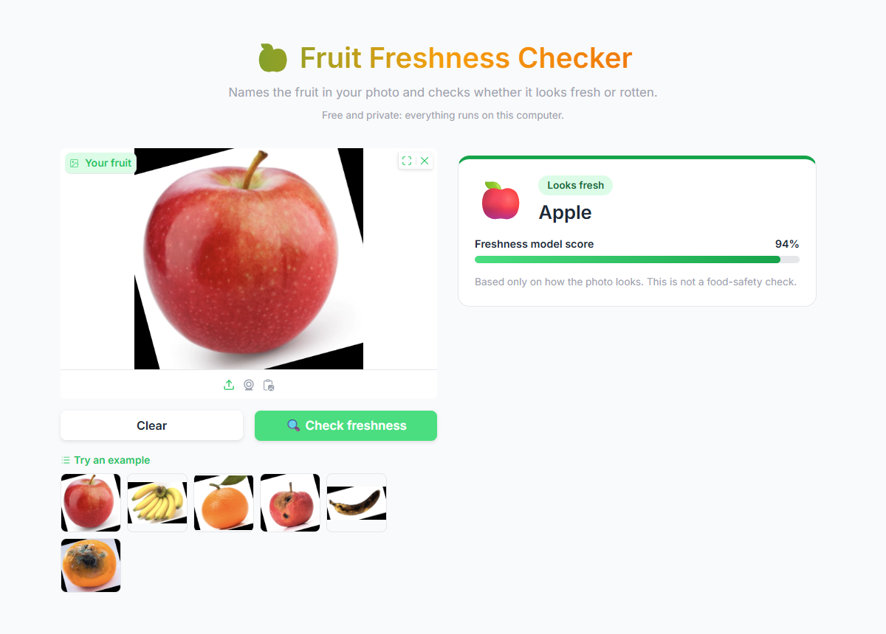
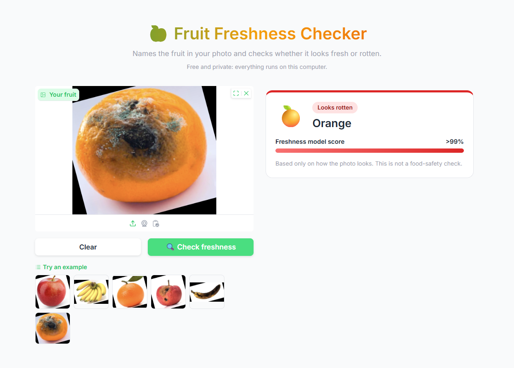
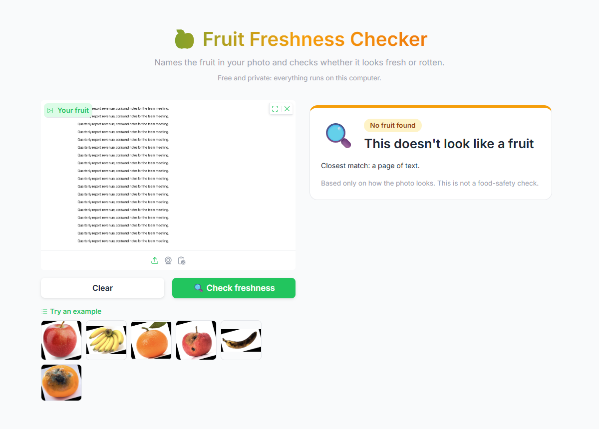
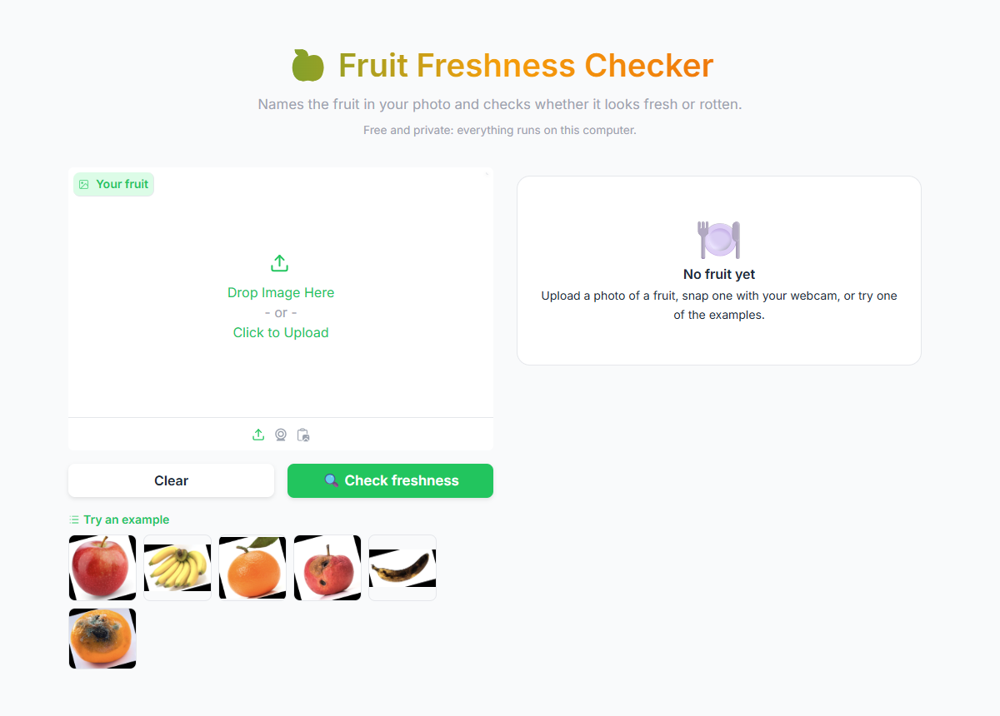
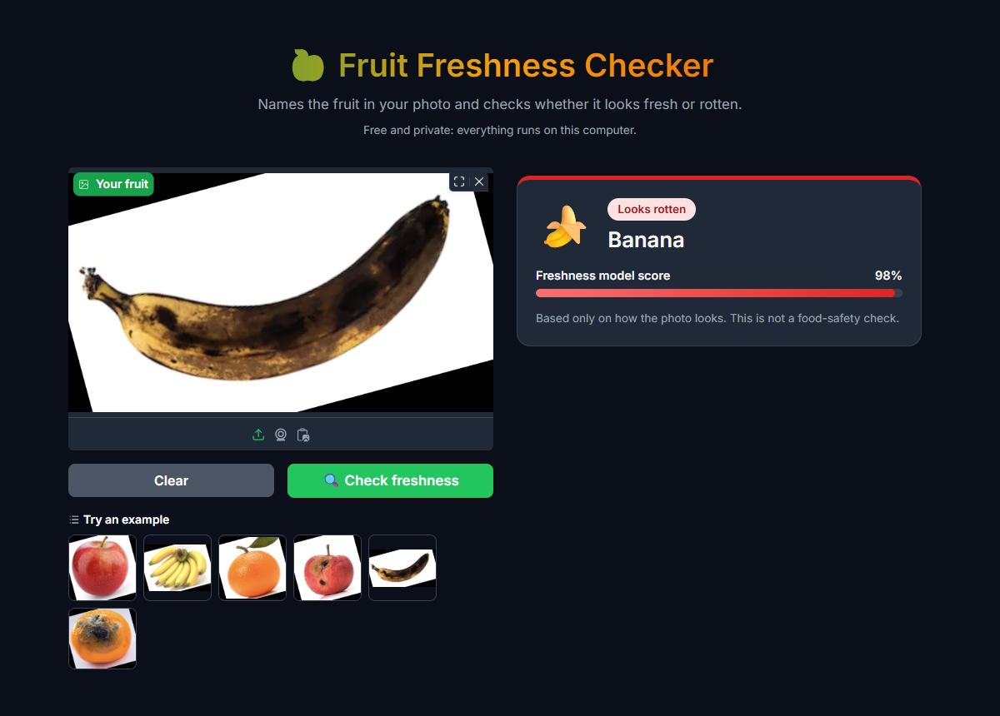

# Fruit Edibility Detection System

A machine learning web app that looks at a photo of a fruit, names the fruit, and judges whether it looks fresh or rotten.
It is free and runs entirely on your computer: no API key, and photos are never uploaded anywhere.

## Features
- **Names the fruit** from about 50 common fruits, and says when a photo shows no fruit at all.
- **Fresh or rotten** verdict with the model's score.
- **Honest warnings** when the model is unsure, and a caution note for fruits the freshness model was not trained on.
- Upload a photo, use your webcam, paste from the clipboard, or try the built-in examples.
- Light and dark mode.

## Screenshots

| Rotten fruit | No fruit in the photo |
|---|---|
|  |  |

| Start screen | Dark mode |
|---|---|
|  |  |

## Getting started
1. Clone the repository.
2. Install the required packages: `pip install -r requirements.txt`
3. Run the app: `python app.py`, then open http://127.0.0.1:7860

The first run downloads the two CLIP models (about 2.3 GB). After that, the app starts without internet access.
Each photo takes a few seconds to analyse on a CPU.

## How it works
- **Naming the fruit:** the open [CLIP ViT-L/14](https://huggingface.co/openai/clip-vit-large-patch14) model compares
  the photo with text such as "a photo of a mango" for each fruit, plus a few non-fruit descriptions
  (a person, a page of text, a meal...) so it can say when there is no fruit.
- **Fresh or rotten:** a logistic-regression classifier trained on this repo's dataset, using image embeddings from the
  smaller [CLIP ViT-B/16](https://huggingface.co/openai/clip-vit-base-patch16) model. The training script is
  `train_freshness.py`, and the trained weights are in `freshness_head.npz`.

To retrain the freshness classifier, run `python train_freshness.py`. It prints the test accuracy and writes `freshness_head.npz`.

## Measured accuracy
Measured on the dataset's test images, which contain only apples, bananas and oranges.

| Task | Accuracy |
|---|---|
| Fresh vs rotten (2,698 test images) | 97.3% (apples 95.8%, bananas 99.1%, oranges 97.1%) |
| Fresh vs rotten on a fruit left out of training (train on two fruits, test on the third) | 84–91% |
| Naming the fruit (random sample of 600 test images, 100 per class) | 84.3% (apples 79.0%, bananas 95.5%, oranges 78.5%) |

Naming is counted as correct only for the exact fruit: "apple" or "green apple" for apples, "banana" for bananas
and "orange" for oranges. The most common mistakes are apples named as nectarines or persimmons, and oranges named as persimmons.

## Limitations
- The freshness model was trained only on apples, bananas and oranges. For other fruits its accuracy has not been measured,
  and the app shows a caution note.
- Naming accuracy for fruits outside the dataset has not been measured.
- "Plantain" is not in the fruit list, because CLIP could not tell bananas and plantains apart in testing.
- Results are based only on how the photo looks. This is not a food-safety check.
- The training data includes some empty (0-byte) image files, which are skipped.

## Project files
| File | What it is |
|---|---|
| `app.py` | The Gradio web app. |
| `train_freshness.py` | Trains and evaluates the freshness classifier. |
| `freshness_head.npz` | The trained freshness classifier (5 KB). |
| `requirements.txt` | Python packages, with the versions the app was tested with. |
| `project.ipynb` | The original notebook: a small TensorFlow CNN on 20×20-pixel images. It needs TensorFlow, which is not in `requirements.txt`. |
| `Dataset/` | Training and test images of fresh and rotten apples, bananas and oranges. |
| `docs/screenshots/` | The screenshots in this README, taken from the running app. |
